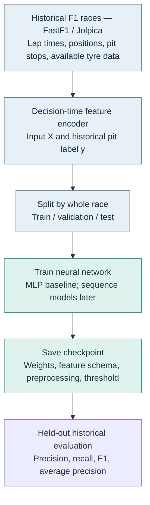
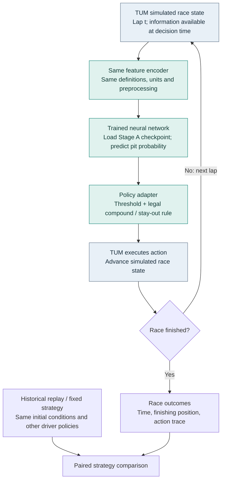

# F1 Meets AI | CS 682

**Can a neural network trained on historical Formula 1 race data make competitive pit-stop decisions inside a race simulator? Does using a history of laps improve those decisions compared with using only the current race state?**

## Why this project matters

A pit stop trades immediate time loss for improved future tyre performance. A strategist must make that decision with incomplete information about traffic, tyre degradation and race conditions. Historical pit stops give us examples of human decisions, but matching them is not the same as making good decisions. We want to investigate that gap: first measure how well models predict historical pit stops, then evaluate what happens when those models actually control a driver's strategy in a simulator.

This is a retrospective, simulation-based study, not a claim of real-world optimality or a live race engineering system.

## Project architecture

The workflow has two stages: learn a pit-decision model from historical data, then test the same fitted model in a closed-loop simulation. The shared feature encoder connects them.

### A. Offline training and prediction evaluation



Training examples use only values available before the predicted pit action. Model selection and threshold tuning use validation races; test races remain held out. A saved checkpoint is the artifact that Stage B consumes.

### B. Closed-loop simulated decision-making



The network receives simulated observations after an intervention, not future historical states. Its fitted weights remain fixed during this evaluation. Predicting past actions and improving simulated race outcomes are different research questions. Neither diagram claims that the trained-policy integration is complete.

- **Data:** FastF1 race timing and tyre data, with one ordered sequence per driver/race. Features and labels must be separated at the point when a pit decision can be made.
- **Models:** a fixed tyre-age rule, logistic regression or MLP as a current-state baseline, then a causal GRU/LSTM (TCN if feasible) to test whether history adds information. An MLP learns nonlinear relationships between current features; a GRU/LSTM processes ordered observations and can retain information from prior laps.
- **Simulator:** TUMFTM race-simulation advances the race, supplies decision-time state, applies a policy's pit/compound decision and provides the resulting race outcomes. We reuse existing race dynamics rather than implement a second simulator.
- **Evaluation:** assess pit prediction on held-out whole races (precision, recall, F1, PR-AUC); then compare policies in identical simulated conditions using race time, finishing position and points. Use paired seeds when adding random events. Bi-LSTM, if explored, is offline only because it uses future context.

## Connection to prior work

- Heilmeier et al. (2020), *Virtual Strategy Engineer: Using Artificial Neural Networks for Making Race Strategy Decisions in Circuit Motorsport* ([paper](https://doi.org/10.3390/app10217805)): provides the strategy-engine and simulation framework. Its supervised VSE separates tyre-change and compound-choice decisions.
- Sasikumar et al. (2025), *Data-driven pit stop decision support for Formula 1 using deep learning models* ([paper](https://doi.org/10.3389/frai.2025.1673148)): motivates learning pit decisions from FastF1 lap sequences and comparing sequential architectures.
- Our question connects the two approaches: does better historical prediction translate into better simulated race outcomes? This is a research question, not a result we have already established.

Upstream simulator: [TUMFTM/race-simulation](https://github.com/TUMFTM/race-simulation). Historical data library: [FastF1](https://github.com/theOehrly/Fast-F1).

## Current status (November 20, 2026)

| Component | Status / evidence |
|---|---|
| Simulator | Original TUM implementation runs locally in Python 3.11; vendor code retained. |
| Historical replay | Local 52-lap replay and controlled timing intervention executed; evidence in [PR #6](https://github.com/hitotoro24/cs682-f1-meets-ai/pull/6). |
| Historical data | Public Jolpica classification, VER lap times and pit records retrieved; richer FastF1 session extraction blocked by account access. |
| Neural network | Three-feature PyTorch MLP and synthetic training smoke test implemented; three pipeline tests passed locally. Real-data training not yet established. |
| Learned policy | Manual VSE intervention executed. A trained historical-data policy is not yet deployed. |

### Silverstone 2019 proof of concept

| Verstappen strategy | Pit laps | Finish | Race time (s) |
|---|---|---:|---:|
| Real race | 13, 20 | P5 | 4907.910 |
| TUM historical replay | 13, 20 | P2 | 4890.732 |
| TUM delayed second stop | 13, 24 | P8 | 4920.468 |

The controlled timing intervention held other driver schedules, the first stop, compound sequence and event inputs fixed. Both scenarios completed 52 laps, with identical trajectories through lap 19. Delaying the second stop added 29.736 seconds in the simulator. This is evidence of a working experimental environment, not a trained-NN result or real-world optimality.

Review the [executed notebook](https://github.com/hitotoro24/cs682-f1-meets-ai/blob/6364d0e15e55c88c0a5e5c11a6c14cb63ca5921b/02_silverstone_simulator_walkthrough.ipynb), [verification record](https://github.com/hitotoro24/cs682-f1-meets-ai/blob/6364d0e15e55c88c0a5e5c11a6c14cb63ca5921b/docs/silverstone_2019_run.md) and [52-lap trace](https://github.com/hitotoro24/cs682-f1-meets-ai/blob/6364d0e15e55c88c0a5e5c11a6c14cb63ca5921b/docs/experiments/ver_stop_timing_trace.csv). These artifacts are pinned to the reviewed experiment commit while PR #6 is open.

## Start here

- [Shared pipeline](f1_ai/pit_pipeline.py): NumPy encoding, historical examples, PyTorch MLP and VSE intervention.
- [Experiment plan](docs/experiment_plan.md): E0–E5, dependencies and acceptance criteria.
- [Team execution guide (PR #5)](https://github.com/hitotoro24/cs682-f1-meets-ai/pull/5): interfaces, handoffs and run records.

From the repository root, in the compatible Python 3.11 environment:

```bash
python -m f1_ai.pit_pipeline smoke
python -m pytest -q
python -m f1_ai.pit_pipeline race
python -m f1_ai.pit_pipeline data  # currently requires session-data access
```

The smoke test is synthetic, not generalization evidence. The manual VSE one-stop policy (lap 24 only) is distinct from the controlled two-stop timing comparison above. See the verification record for dependency setup and exact run commands.

## Reproduce the existing replay

From the repository root, using Python 3.11:

```bash
cd race-simulation
python3.11 -m venv .venv
source .venv/bin/activate
python -m pip install -r requirements.txt
python experiments/sanity_check.py
```

This script replays strategies from the 2019 Silverstone parameter file with stochastic effects disabled, obtains historical results through FastF1's Ergast/Jolpica interface, and exports a comparison CSV. See the [upstream README](race-simulation/README.md) and [requirements](race-simulation/requirements.txt). The requirements note that historical lap data access may have additional account requirements; check access before expanding the data pipeline. Commands are documented from the repository, not newly executed here.

## Immediate milestone: one decision at Silverstone 2019

Use Max Verstappen (VER) as the initial target driver, with other drivers following existing strategies. Start with one lap and one deterministic run before expanding to multiple drivers or training complex networks.

1. Extract one historical driver/lap example with a clearly defined decision timestamp and pit label.
2. Identify the equivalent simulator decision-time state in `VSE.decide_pitstop` ([source](race-simulation/racesim/src/vse.py)).
3. Document how each shared feature is calculated on both sides. The same schema, units, encoding and timing must be used at training and inference.
4. Pass simulator state to a simple test policy; confirm that the returned pit/no-pit action (and valid compound, if applicable) reaches the simulator. Log inputs and decisions. Then check a full race with the same policy.

**Proposed expanded feature contract (to validate together):**

| Field | Meaning / constraint |
|---|---|
| race progress | (current lap - 1) / planned race laps for start-of-lap decisions |
| tyre age | laps on current tyre set at decision time; reconcile simulator degradation-age semantics |
| compound | current tyre compound mapped consistently across sources |
| position | position known before the pit decision |
| gap ahead / behind | seconds relative to nearest relevant cars, with explicit missing/lapped-car convention |
| SC/VSC | status known at the decision time, not future phase information |
| used two compounds | whether two distinct dry compounds have already been used |
| driver ID | stable identity mapping |
| pit label / fitted compound | training targets only; never input features for that same action |

Do not assume the FastF1 end-of-lap row exactly matches the simulator pre-pit state. Pit-in timing, final lap time, post-pit position and next compound can leak the action into features. Confirm alignment and use prior-lap information where necessary. The toy one-lap example is a wiring test, not a training sample sufficient to fit a model.

## Team workstreams

| Workstream | Immediate output | Report section |
|---|---|---|
| [Integration](https://github.com/hitotoro24/cs682-f1-meets-ai/issues/1) | Shared feature mapping for one VER lap, including decision timing and a logged comparison of historical vs simulator fields; coordinate integration. | Introduction, integration, experimental design |
| [Simulator](https://github.com/hitotoro24/cs682-f1-meets-ai/issues/2) | Reproduce the committed replay; identify the VSE entry/exit contract and test a simple custom policy for VER without changing other drivers. | Simulator, policy integration |
| [Models](https://github.com/hitotoro24/cs682-f1-meets-ai/issues/3) | Design a current-state MLP baseline and later a causal GRU/LSTM using a common input schema; provide a small forward-pass test and document model input/output shapes. | Model methods, sequence comparison |
| [Data and evaluation](https://github.com/hitotoro24/cs682-f1-meets-ai/issues/4) | Audit historical features/labels and class imbalance; define race-level splits and prediction metrics; check the one-lap example for leakage. | Data, evaluation, limitations |

Before the next meeting (proposed checkpoint: Sunday November 22 at 3 PM), each workstream should produce a small PR or an issue comment containing the exact artifact produced, how it was tested, and any blocker. See the issue tracker and November 20 team meeting notes for current ownership. Keep Notion for coordination and GitHub for reproducible artifacts; everybody contributes to the report.

## Scope after the milestone

The proposal plans historical training across the whole field (2019–2025, race-level 70/15/15 split within seasons), evaluation on five drivers, and comparisons under starting positions P1/P10/P18 and SC/VSC. Those are later experiments, not prerequisites for the first working connection. Consider holding out Silverstone to test track generalization. Validate thresholds on validation data, never on the test races. Expand only once the baseline runs reproducibly and the team agrees on the decision-time contract.

## Contributing

Keep `main` as the shared entry point: project overview, architecture, setup instructions and reviewed reusable code/results. Do development and exploratory experiments on separate owner/task branches. Keep changes focused and open a PR with purpose, inputs/outputs, reproducible command, observed result and limitations. Review before merging; no experimental branch is automatically merged into main. Do not commit raw credentials, account data or large downloaded caches. Preserve upstream code attribution and licenses. Keep the course project separate from unrelated F1 optimization repositories.

Team: Anh Nguyen, Henry Yang, Tony Hwang, Shujie Hua.
